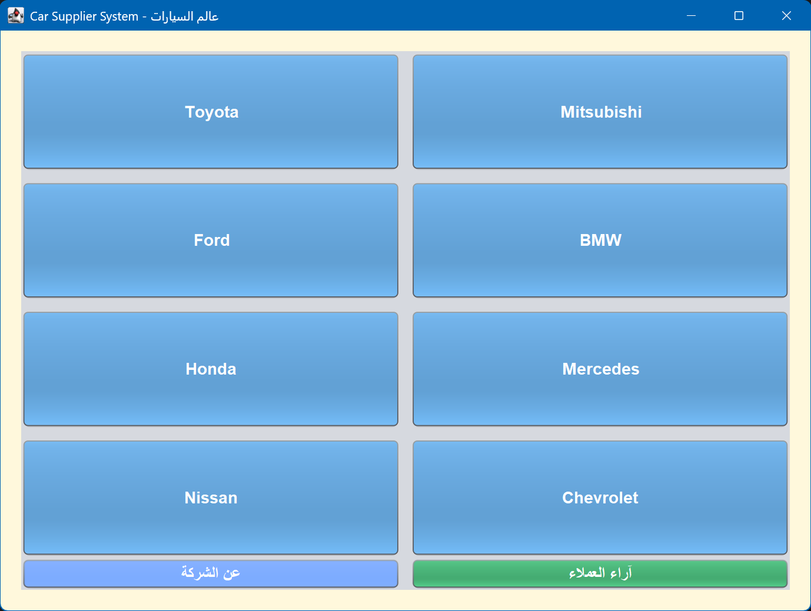
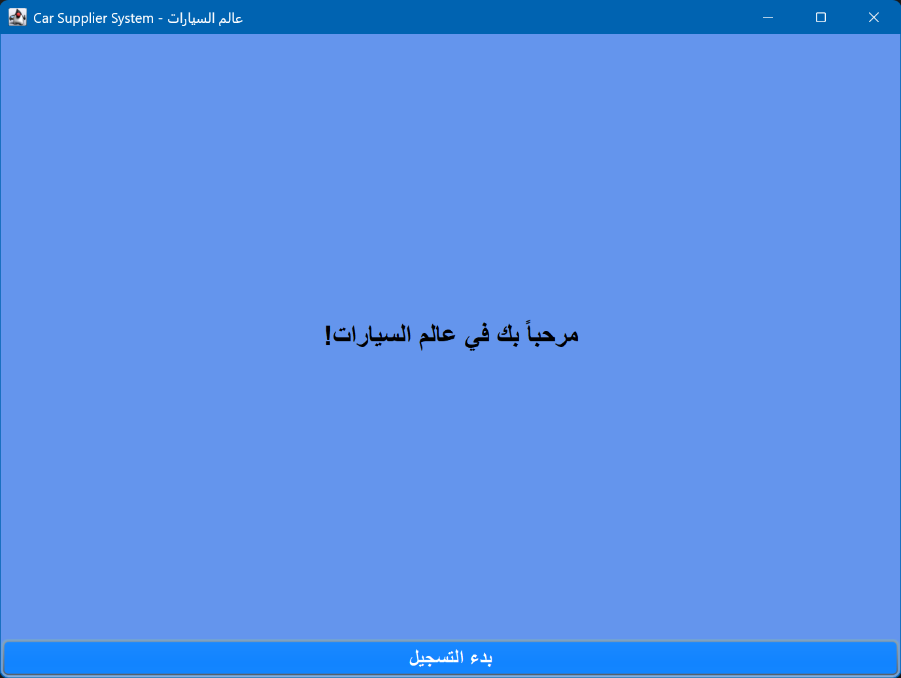
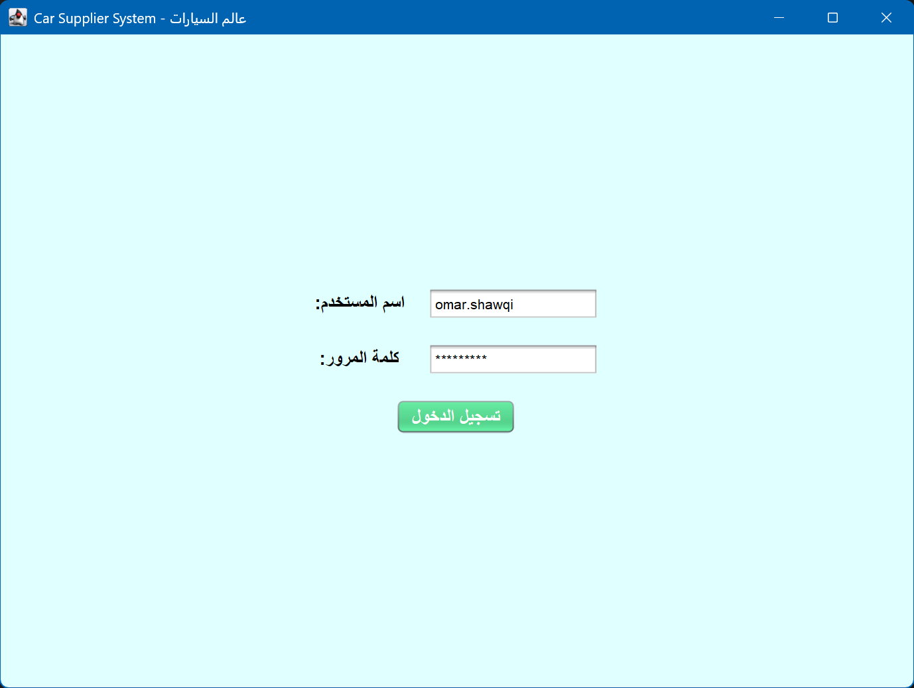
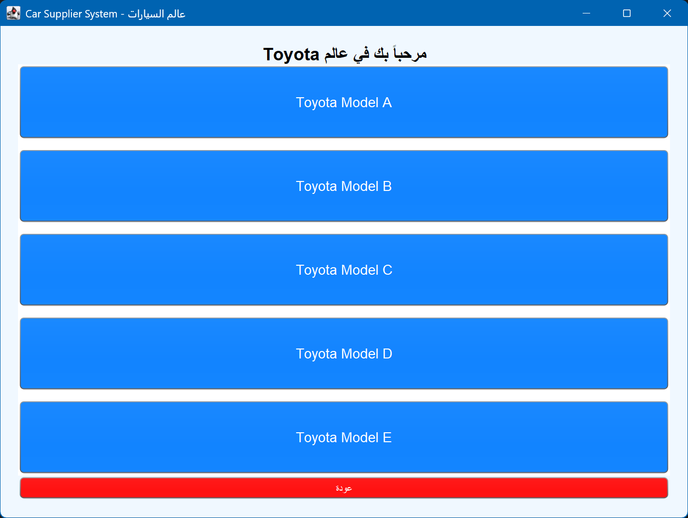
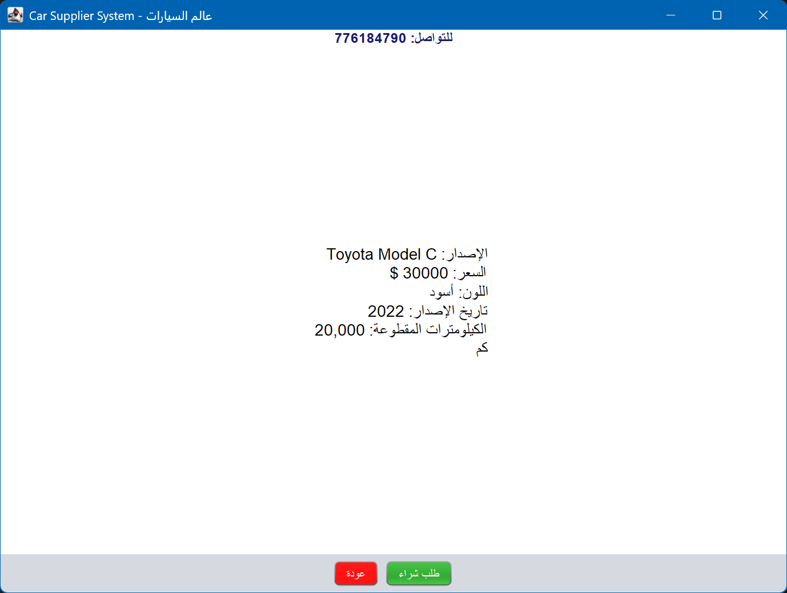
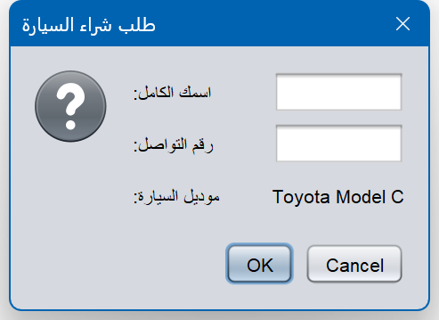
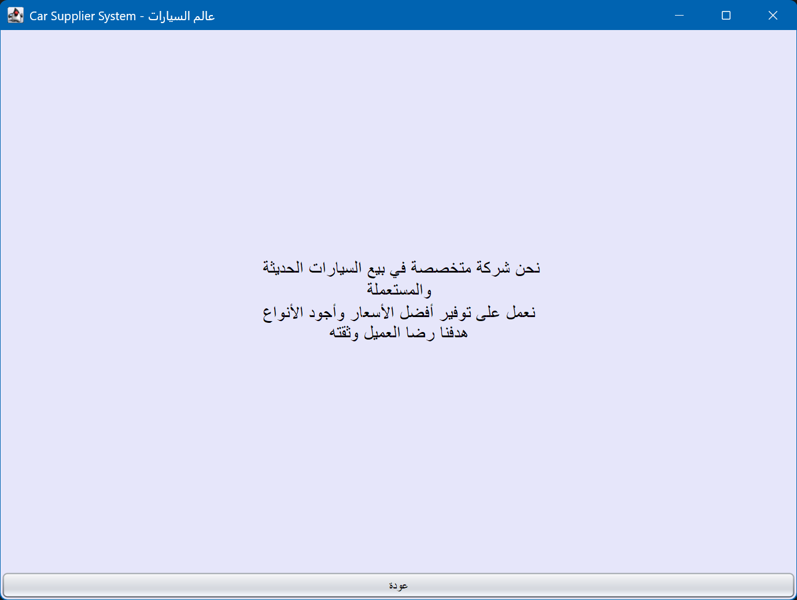

# Car Supplier System · عالم السيارات

A Java Swing desktop application with an Arabic-first interface for browsing a car dealer's catalogue and sending a purchase request. Built as a team project at the International University of Technology Twintech (IUTT), Sana'a, Yemen, in 2024.



## What it does

The app walks a customer through a complete flow, one screen at a time:

**Welcome → Login → Brand → Model → Details → Purchase request**

- **Login screen** with input validation: empty username or password shows an Arabic error dialog
- **8 car brands** (Toyota, Mitsubishi, Ford, BMW, Honda, Mercedes, Nissan, Chevrolet), **5 models each**: 40 listings in total
- **Details view** for every model: version, price, colour, year and mileage
- **Purchase request form** that collects the customer's name and phone number for the selected model
- **About the company** and **customer reviews** pages
- Back navigation from every screen

## Screenshots

| Welcome | Login |
|---|---|
|  |  |

| Models | Details |
|---|---|
|  |  |

| Purchase request | About the company |
|---|---|
|  |  |

## How it is built

- **Java + Swing**: a single `JFrame` with the Nimbus look and feel
- **`CardLayout`** switches between screens inside one window, the same pattern as a single-page app
- **Event-driven GUI**: every button uses a lambda `ActionListener`
- **Layout managers**: `BorderLayout`, `GridBagLayout` for the login form, `GridLayout` for the brand and model grids
- **Collections**: brand → models and brand → details stored in `HashMap<String, String[]>`
- **Dialogs**: `JOptionPane` for validation errors, the purchase form and the confirmation message
- **Arabic text** rendered in Swing labels and buttons, with HTML labels for multi-line right-aligned content

## Run it

Requires JDK 8 or newer.

```bash
javac -encoding UTF-8 CarnewSuppliersystem1.java
java CarnewSuppliersystem1
```

## What I would improve today

Looking back at this code two years later, these are the next steps I would take:

- Move the car data into a `Car` model class and load it from a file or database instead of hard-coded strings
- Split each screen into its own class instead of one large constructor
- Reuse the model and details panels instead of adding a new card on every click
- Set `ComponentOrientation.RIGHT_TO_LEFT` so the whole layout mirrors properly for Arabic
- Save purchase requests so the dealer can actually see them

## Author

**Omar Shawqi Al-Ariqi**, Computer Science student at Albukhary International University, Malaysia
[GitHub](https://github.com/OMARSHAWQI7722)

Originally built as a team project at IUTT, Sana'a, Yemen (2024).

## License

MIT
